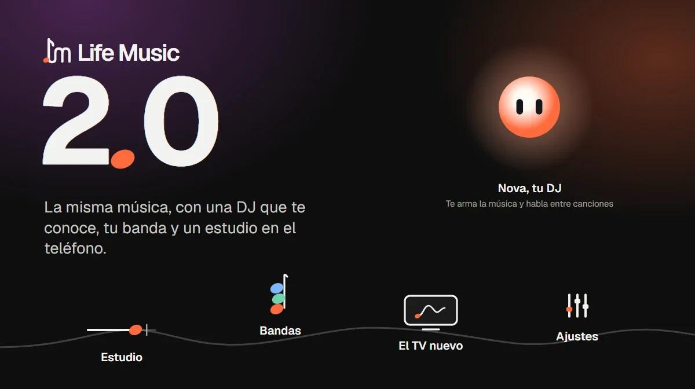
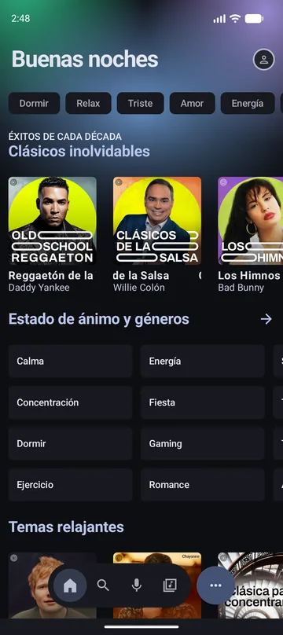
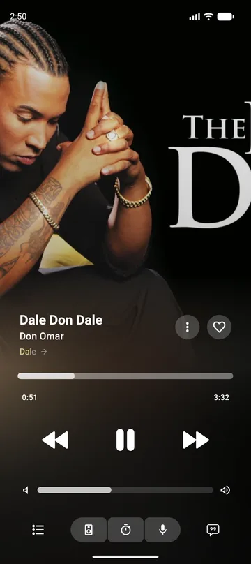
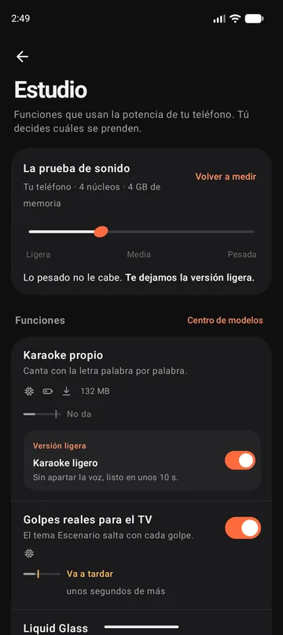
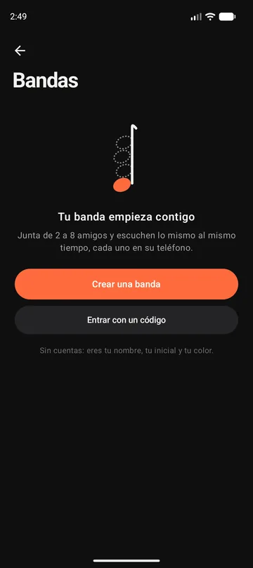
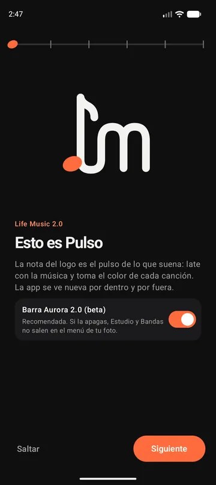
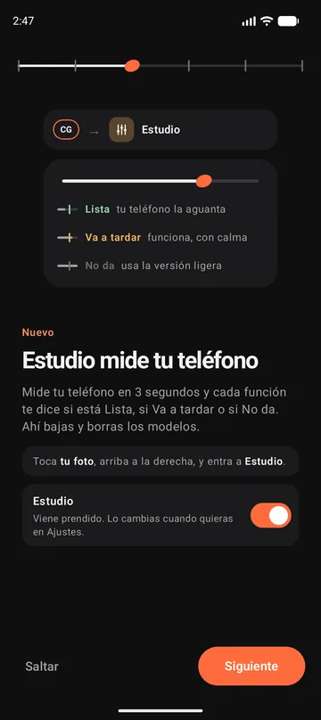
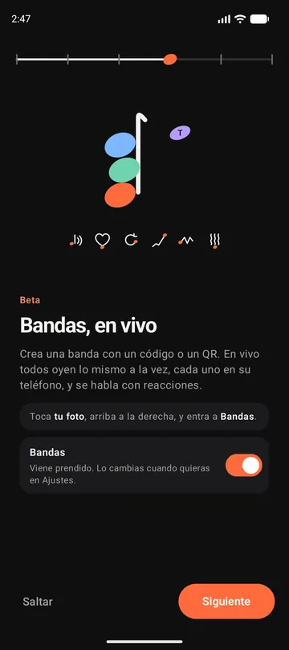

<div align="center">
  

  <h1>Life Music</h1>

  <p><b>Cliente de música para Android. Un desarrollo de CG LABS.</b></p>

  <p>
    <a href="https://lifemusic.app"><b>lifemusic.app</b></a> ·
    <a href="https://lifemusic.app/apk"><b>Descargar</b></a> ·
    <a href="https://lifemusic.app/novedades">Novedades</a> ·
    <a href="PRIVACY_POLICY.md">Privacidad</a>
  </p>

  <p>
    
    
    
    
  </p>
</div>

<p align="center">
  
</p>

> ### ⚠️ Proyecto educativo y sin ánimo de lucro
>
> Life Music **no es un producto comercial**: no se vende, no lleva publicidad y no acepta donaciones. Existe para
> aprender arquitectura Android, procesamiento de audio, IA en el teléfono y diseño de interfaz sobre una base real y
> compleja. No está afiliado a Google, a YouTube ni a ninguno de los proyectos de los que desciende. Lea el
> [aviso legal](#aviso-legal) antes de usarlo.

> **In English** — Life Music is a **non-commercial, educational** Android music client by CG LABS. It is a fork of
> [Echo Music](https://github.com/EchoMusicApp/Echo-Music), which descends from Vivi Music / Metrolist and InnerTune,
> licensed under **GPL-3.0**. Version 2.0 adds an on-device AI DJ (Nova), a Studio for on-device models (word-by-word
> karaoke), Bands to listen live with friends, and a new identity called Pulse. No ads, no telemetry, not affiliated
> with Google or YouTube. See [Credits](#créditos-y-linaje).

---

## Capturas

<table>
  <tr>
    <td align="center"><br/><sub>Inicio con Aurora</sub></td>
    <td align="center"><br/><sub>Reproductor y Life Line</sub></td>
    <td align="center"><br/><sub>Estudio</sub></td>
    <td align="center"><br/><sub>Bandas</sub></td>
  </tr>
  <tr>
    <td align="center"><br/><sub>Bienvenida: Pulso</sub></td>
    <td align="center"><br/><sub>La prueba de sonido</sub></td>
    <td align="center"><br/><sub>Bandas, en vivo</sub></td>
    <td></td>
  </tr>
</table>

## Descargar

La última versión está siempre en **[lifemusic.app/apk](https://lifemusic.app/apk)** y en
[Releases](https://github.com/cgus392-cmd/Life-Music/releases/latest). Requiere **Android 8.0** o más. Una vez
instalada, la app avisa sola de las versiones nuevas y se actualiza sin salir de ella.

| APK | Para quién |
|---|---|
| `lifemusic-arm64.apk` | Casi todos los teléfonos de los últimos años. La más recomendada |
| `lifemusic-armv7.apk` | Teléfonos viejos de 32 bits |
| `lifemusic-x86_64.apk` | Chromebooks y emuladores modernos |
| `lifemusic-x86.apk` | Equipos x86 viejos de 32 bits |
| `lifemusic.apk` | Universal: cualquier teléfono Android, si no sabes cuál bajar |

La app sabe cuál es la tuya: cuando se actualiza sola, baja la de tu arquitectura.

## Qué es

Life Music es una **versión modificada de [Echo Music](https://github.com/EchoMusicApp/Echo-Music)**, un cliente de
terceros para YouTube Music. No se construyó desde cero: se partió de un proyecto maduro para centrarse en lo que aporta
valor —funciones nuevas y decisiones de diseño propias— en vez de reimplementar un reproductor. La mayor parte del
código que hace que esto funcione lo escribieron otras personas, y sus nombres están [más abajo](#créditos-y-linaje).

## Lo que trae Life Music 2.0

### Pulso, la identidad nueva
El logo es una nota cuya cabeza es **el pulso de lo que suena**: late con la música y toma el color de cada canción.
Seis versiones del ícono para elegir (Carbón, Blanco, Gris, Tinta, Coral y Sobre coral), el ícono temático de Material
You, y **Aurora**: el degradado del Inicio con los colores de la canción, que al bajar se vuelve vidrio.

### Nova, tu DJ
Arma la música por bloques y **habla entre canciones**, como en la radio. Las voces HD funcionan **dentro del
teléfono, sin internet**. Se le elige el nombre, cómo te dice, su acento, su ritmo (pausado, normal o ágil) y cada
cuántas canciones habla. Si la voz no alcanza a estar lista, el anuncio sale escrito en Life Line: Nova nunca se queda
muda.

### Estudio
El lugar de las funciones que usan la potencia del teléfono. Se entra tocando tu foto.
- **La prueba de sonido** mide el teléfono y dice, función por función, si está **Lista**, si **Va a tardar** o si
  **No da**, y en ese caso ofrece una versión ligera.
- **El centro de modelos** muestra lo que bajaste, cuánto pesa y cuánto espacio te queda.
- **Karaoke propio (beta):** la letra que llega por línea se pasa a **palabra por palabra** en el teléfono, separando la
  voz de la música y escuchándola. Desde la 2.0.1 se invita encima de la letra misma.

### Bandas (beta)
Grupos de 2 a 8 amigos que entran con un **código o un QR**, sin cuentas. **En vivo**, todos escuchan lo mismo al mismo
tiempo, cada uno desde su teléfono y con la cola compartida, y se habla solo con seis reacciones propias. Usa un
servidor propio que no guarda nada de lo que se escucha.

### Life Line y su voz
Una sola línea de la letra bajo el artista, en el reproductor, **resaltada palabra por palabra**. El barrido se calcula
en espacio de caracteres, para que el degradado caiga donde está el texto. Cuando no hay letra, **habla la app**, y cada
frase sale de una señal real del reproductor:

| dice | porque |
|---|---|
| *Fundiendo las notas…* | hay un fundido cruzado en curso |
| *Enlazando con lo que viene* | la app encadenó la siguiente pista |
| *Se fue el internet* | esperando conexión |
| *Esta se canta con el cuerpo* | ningún proveedor tiene letra |

### Modo karaoke
La letra a pantalla completa, palabra por palabra: se ve la línea siguiente, hay cuenta atrás en los pasajes
instrumentales y la palabra que suena va en color de acento. Incluye una **reducción rápida de voz** por cancelación de
centro en banda (se conserva el bajo bajo 200 Hz y el aire sobre 7,5 kHz); es resta, no separación, y la app lo dice.

### Life Music TV
Transmite al TV **sin servicios de Google**, por protocolo abierto, a un **receptor propio** con temas (Atardecer,
Tocadiscos, Escenario que salta con los golpes reales de la canción, Liviano…). ¿El TV no tiene Cast? Se abre
[lifemusic.app/tv](https://lifemusic.app/tv) en su navegador y se enlaza con un código que vence a los 5 minutos.

### Comunidad y privacidad
**Sin telemetría, sin publicidad y sin venta de datos.** Calificar la app con estrellas o entrar a una banda no pide
cuenta: solo sale algo cuando se toca el botón, va a servidores propios en Cloudflare y en público solo se ven contadores.
Los detalles están en la [política de privacidad](PRIVACY_POLICY.md).

## Lo nuevo en la 2.0.2 (mantenimiento)

- **Ya no desaparecen canciones.** La sincronización con YouTube borraba «me gusta», canciones de la biblioteca y
  listas que nunca llegaron allá, o que no cargaron completas. Ahora solo quita lo que se quitó en YouTube, sube lo que
  falta y, si la respuesta viene incompleta, no borra nada. Diez pruebas automáticas cuidan ese comportamiento.
- **Modo ligero automático** en teléfonos de gama baja: apaga una sola vez los efectos más pesados, solo si nadie los
  había tocado.
- El ícono de Cast conectado ya no se deforma, los campos de texto de Nova escriben en orden y tres ajustes que
  mostraban un valor distinto al real ahora dicen la verdad.
- El APK universal baja de 126 MB a 78 MB.

## Correcciones sobre la base heredada

- La letra **se descargaba en el hilo principal**, congelando la interfaz en cada cambio de pista. Ahora va en
  `Dispatchers.IO`.
- El colector que traía la letra colgaba de una preferencia que **no escribía nadie**: llevaba muerto desde antes del
  fork.
- `google-services.json` apuntaba al **proyecto de Firebase de Echo**. Retirado: el fork no envía analítica ni fallos
  a infraestructura ajena.
- El auto-actualizador ofrecía instalar el APK de **Echo**. Redirigido a Life Music —toda la identidad del repositorio
  vive en `constants/Repo.kt`— y unificado: aviso, notificación y comprobación en segundo plano llevan al actualizador
  de la app, que descarga, verifica e instala sin salir.
- La sincronización con YouTube **borraba lo local** que no venía en la respuesta (ver 2.0.2).

## Créditos y linaje

Life Music no existiría sin este trabajo previo. Todos los proyectos de la cadena están bajo **GPL-3.0**:

```
InnerTune  (z-huang)
   └─ Metrolist / Vivi Music  (vivizzz007)
        └─ Echo Music  (EchoMusicApp)
             └─ Life Music  (CG LABS)
```

Echo Music acredita a su vez a **ArchiveTune**, **SimpMusic**, **Better Lyrics**, **Music Recognizer** y **BravePipe**.
Los avisos de copyright de terceros presentes en el código —incluidos los de **Chartreux Westia** en los módulos de
Spotify— se conservan intactos, tal como exige la GPL-3.0 en sus secciones 4 y 5. Los módulos que se llaman como su
fuente (`echomusiccanvas`, `applecanvas`, `kugou`, `lrclib`, `paxsenixlyrics`, `simpmusic`, `unison`) **conservan su
nombre**: identifican al servicio del que obtienen datos, no a esta app.

**Tecnologías de la 2.0**, cada una bajo su propia licencia:
[sherpa-onnx](https://github.com/k2-fsa/sherpa-onnx) (k2-fsa) y ONNX Runtime para correr los modelos en el teléfono;
los modelos de reconocimiento **NVIDIA NeMo**, el separador de voz **UVR MDX-Net** y las voces **Piper** (Rhasspy) y
**Kokoro** para Nova; y **ZXing** para los QR de Bandas. El detalle de cada modelo está en la app, en
*Estudio › Centro de modelos › Licencias*, y la pantalla **Acerca de** repite estos créditos.

## Licencia

**GPL-3.0.** No es una elección: es una obligación heredada. El copyleft se dispara al *distribuir*, no al *vender*,
así que el carácter educativo y gratuito del proyecto no exime de nada: el repositorio es público, el código fuente
está disponible, los avisos de copyright de toda la cadena se conservan y cualquier trabajo derivado tiene que seguir
siendo GPL-3.0. El texto completo está en [LICENSE](LICENSE).

## Compilar

```bash
git clone https://github.com/cgus392-cmd/Life-Music.git
cd Life-Music
./gradlew assembleArm64FossDebug
```

Requisitos: **JDK 21**, Android SDK 36, NDK 27.0.12077973.

El proyecto tiene **18 módulos Gradle** y dos dimensiones de sabor:

- **`foss`** (por defecto) / **`gms`**: sin o con servicios de Google.
- **`arm64`**, **`armeabi`**, **`x86`**, **`x86_64`**, **`universal`**: desde la 2.0.2 la universal lleva solo las ABI
  de teléfonos (ARM de 32 y 64 bits); los emuladores x86 tienen su propio sabor.

Las pruebas de la sincronización corren con `./gradlew :app:testUniversalFossDebugUnitTest`.

**Stack:** Kotlin 2.3.10 · Jetpack Compose · Material 3 · Media3/ExoPlayer 1.7.1 · Room 2.8.4 · Hilt 2.59.1 ·
Ktor 3.4.0 · sherpa-onnx · minSdk 26 · targetSdk 36.

## Aviso legal

Life Music accede a contenido de YouTube Music mediante APIs no oficiales, lo que **va en contra de sus términos de
servicio**. Proyectos de esta misma familia han recibido reclamaciones DMCA.

Se publica exclusivamente con fines **educativos y de investigación**. No se distribuye contenido protegido: la
aplicación es un cliente, y todo el material pertenece a sus respectivos titulares. Quien lo use asume la
responsabilidad de hacerlo conforme a la legislación de su país.

Si usted representa a un titular de derechos y considera que este repositorio infringe alguno, abra una incidencia y
se atenderá.

---

<div align="center">
  <br/>
  <sub>Un desarrollo de <b>CG LABS</b> · © 2026 · Firmado: CG</sub>
</div>
